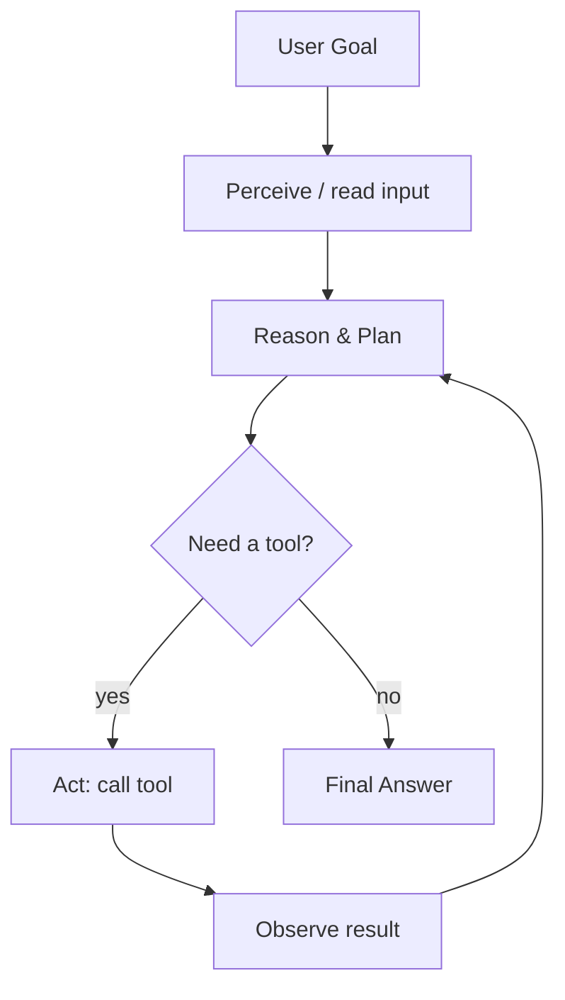
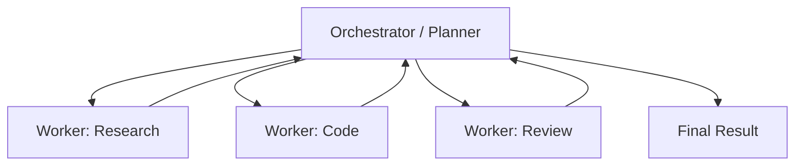
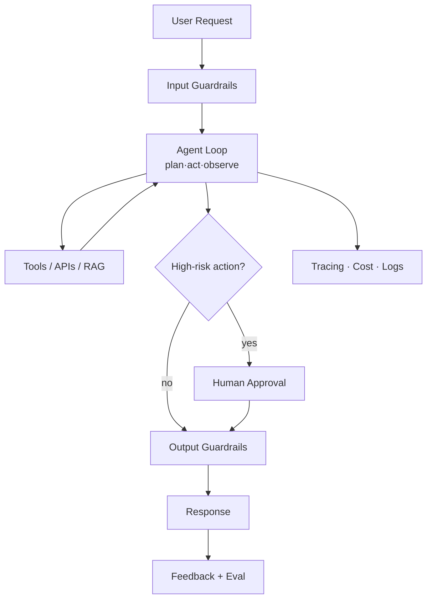

# 🤖 Agentic AI Engineer Guide — Basic → Advanced → Production → Interview

> End-to-end resource to master building AI agents.
> Every concept is **one checkbox + a one-line explanation** — tick as you learn. Deeper callouts (diagrams, code, tables) appear only where they add value.
>
> **Legend:** 🏭 production-critical · 🎯 common interview question · ⚡ advanced · ⭐ recommended default
> View in VS Code with `Ctrl+Shift+V` (Mermaid diagrams render). Pairs with `RAG_Complete_Guide.md`. Last updated: 2026.

---

## 📑 Table of Contents
1. **Part 0 — The Big Picture** (diagrams)
2. **Part 1 — Foundations** (what, vs others, agent loop, limitations)
3. **Part 2 — LLM Prerequisites**
4. **Part 3 — Core Building Blocks** (tools, reasoning, memory, context engineering, RAG, protocols: MCP/A2A)
5. **Part 4 — Agent Architectures** (single, multi-agent, human-in-the-loop)
6. **Part 5 — Frameworks & Building**
7. **Part 6 — Evaluation**
8. **Part 7 — Production & LLMOps**
9. **Part 8 — Interview** (Q&A + system design)
10. **Part 9 — Hands-On Practice Order**

---
---

# 🧭 PART 0 — THE BIG PICTURE

### The Agent Loop (the core idea)

### Orchestrator–Worker (multi-agent)

- [ ] **What makes it "agentic"** — the LLM **decides actions in a loop** (plan → act → observe → repeat), not a single response.
- [ ] **Agent = Model + Tools + Loop + Memory + Context** — the core ingredients.
- [ ] **Agent = Model + Harness** 🎯 — in 2026, the *harness* (context, tools, orchestration, evals around the model) matters as much as the model.

---
---

# 🟦 PART 1 — FOUNDATIONS

## 1.1 What & Why
- [ ] **What is an AI agent** 🎯 — an LLM that plans, uses tools, and acts in a loop to achieve a goal autonomously.
- [ ] **Agent vs plain LLM** — LLM answers once; an agent reasons, acts, and iterates.
- [ ] **Agent vs RAG** — RAG retrieves then answers; an agent can retrieve, act, and decide across multiple steps.
- [ ] **Agent vs workflow/automation** 🎯 — fixed workflow = predefined steps; agent = LLM decides the steps dynamically.
- [ ] **Agency spectrum** — fixed chains → LLM-routed → fully autonomous; pick the least autonomy that works.
- [ ] **When to use an agent** 🎯 — open-ended, multi-step tasks needing tools/decisions; otherwise prefer a simpler chain.
- [ ] **Example use cases** — personal assistant, coding agent, data analysis, web scraping, NPC/game AI, customer support.

## 1.2 The Agent Loop 🎯
- [ ] **Perceive** — read the user input / environment state.
- [ ] **Reason & Plan** — decide the next step toward the goal.
- [ ] **Act** — invoke a tool / take an action.
- [ ] **Observe** — read the tool result.
- [ ] **Reflect & repeat** — update the plan and loop until done.
- [ ] **Stop condition** — finish on goal completion or a max-iteration limit.

## 1.3 Limitations & Challenges 🎯
- [ ] **Compounding errors** 🎯 — per-step mistakes multiply (10 steps × 95% ≈ 60% end-to-end).
- [ ] **Cost & latency** — many LLM calls per task; agents are expensive and slow.
- [ ] **Reliability / non-determinism** — same input can take different paths.
- [ ] **Infinite loops** — agents can get stuck; need max-iteration caps.
- [ ] **Hallucinated tool calls** — wrong tool/args; need validation.
- [ ] **Context rot** — long histories degrade quality (lost-in-the-middle, outdated info).
- [ ] **Reward hacking** — agents game the objective instead of solving it.
- [ ] **Governance gap** 🏭 — most teams run agents in prod but few can govern them well.

---
---

# 🟩 PART 2 — LLM PREREQUISITES

### Dev prerequisites
- [ ] **Basic backend development** — build and run a simple service.
- [ ] **Git & terminal** — version control and command-line basics.
- [ ] **REST API knowledge** — call and design HTTP APIs (agents live on these).

### LLM fundamentals
- [ ] **Transformers / LLM basics** — how next-token prediction works at a high level.
- [ ] **Tokenization** — text split into tokens; the model's unit.
- [ ] **Context window** — max tokens in one request; agents fill it fast.
- [ ] **Token-based pricing** — you pay per input/output token.
- [ ] **Temperature** — randomness of output (low = deterministic).
- [ ] **Top-p** — nucleus sampling cutoff.
- [ ] **Frequency / presence penalty** — discourage repetition / encourage new topics.
- [ ] **Stop sequences** — strings that end generation.
- [ ] **Max tokens** — cap on output length.
- [ ] **Reasoning vs standard models** 🎯 — reasoning models "think" before answering; better for planning, pricier/slower.
- [ ] **Streaming vs non-streaming** — token-by-token vs full response.
- [ ] **Structured output / JSON mode** — force schema-valid output (critical for tool args).
- [ ] **Open vs closed weight models** — self-hosted vs API; cost/control/privacy tradeoffs.
- [ ] **Model families & licences** — know the major families and their usage licences.
- [ ] **Fine-tuning vs prompt engineering** 🎯 — tune behavior into weights vs steer via prompts; prefer prompting first.
- [ ] **Prompt engineering basics** — be specific, give context, use examples, specify length/format, iterate & test.

---
---

# 🟧 PART 3 — CORE BUILDING BLOCKS

## 3.1 Tools / Function Calling 🏭🎯
- [ ] **What is a tool** — a function the agent can call to act (search, code, API, DB).
- [ ] **Tool definition** 🎯 — name + description + input/output schema the model reads.
- [ ] **Clear name & description** — the model picks tools by these; write them well.
- [ ] **Native function calling** — OpenAI functions, Anthropic tool use, Gemini function calling.
- [ ] **Tool selection / routing** — the model chooses which tool and arguments.
- [ ] **Parallel tool calls** ⚡ — call multiple tools at once (also a latency lever, §7.3).
- [ ] **Error handling & retries** 🏭 — validate args, catch failures, retry/repair.
- [ ] **Tool examples** — web search, code execution/REPL, DB queries, API requests, file system, email/Slack.
- [ ] **Computer use / browser agents** ⚡ — agents that control a real browser/GUI (click, type, navigate).
- [ ] **Tool limiting** 🏭 — fewer, well-scoped tools → more reliable steps.
- [ ] **Return format** — give the model clean, parseable results.

## 3.2 Reasoning & Planning 🎯
*The "thinking" strategies an agent uses — these ARE the single-agent patterns referenced in Part 4.*
- [ ] **Chain of Thought (CoT)** — reason step-by-step before acting.
- [ ] **ReAct** ⭐ — interleave Reasoning + Acting (think → act → observe → repeat).
- [ ] **Plan-and-Execute** — make a full plan first, then execute steps.
- [ ] **Tree of Thought** ⚡ — explore multiple reasoning branches.
- [ ] **Reflection / self-critique (Reflexion)** ⚡ — the agent reviews and retries its own output.
- [ ] **Task decomposition** — break a big goal into sub-tasks.
- [ ] **Replanning** — adjust the plan when a step fails or new info appears.

## 3.3 Memory 🏭🎯
- [ ] **Short-term / working memory** — current task context in the prompt.
- [ ] **Long-term memory** — knowledge persisted across sessions (vector DB/SQL).
- [ ] **Episodic memory** — memories of past events/interactions.
- [ ] **Semantic memory** — general facts and knowledge.
- [ ] **Procedural memory** — learned skills/tools/how-to.
- [ ] **Summarization / compression** — condense history to fit the context window.
- [ ] **Forgetting / aging** — drop or decay stale memories.
- [ ] **State management** — track and persist task state across steps.
- [ ] **Retrieval = RAG** — long-term memory recall uses RAG (see `RAG_Complete_Guide.md`).
- [ ] **Memory frameworks** ⚡ — managed memory layers: Mem0, Zep, Letta (MemGPT).

## 3.4 Context Engineering ⭐🏭🎯
*The 2026 center of gravity — managing everything the model sees, not just the prompt.*
- [ ] **What is context engineering** 🎯 — curating the tools, memory, and data in the model's context window (prompt engineering is a subset).
- [ ] **Context window budget** — treat tokens as a scarce resource; include only what helps.
- [ ] **Compaction** — summarize/compress the running history as it grows.
- [ ] **Tool-result pruning/clearing** — drop old tool outputs that are no longer needed.
- [ ] **Context isolation** — separate sub-agent contexts so they don't pollute each other.
- [ ] **Provenance** — track where each piece of context came from.
- [ ] **Context observability** 🏭 — be able to inspect exactly what entered each model request.
- [ ] **System prompt / AGENTS.md** — durable instructions that guide the agent's behavior.
- [ ] **Lost-in-the-middle** — models ignore mid-context; place key info at the edges.

## 3.5 Knowledge Grounding (RAG)
- [ ] **RAG for agents** — give agents private/fresh knowledge via retrieval.
- [ ] **Agentic RAG** ⚡ — the agent decides when/what/how to retrieve (see RAG guide §3.5).

## 3.6 Agent Protocols & Interoperability ⚡🎯
*2026: standards for how agents connect to tools and to each other.*
- [ ] **MCP (Model Context Protocol)** 🎯 — Anthropic standard connecting agents to **tools & data** uniformly (the de-facto tool standard).
- [ ] **MCP Host / Client / Server** — app consuming context / connector / exposes tools & resources (files, DBs, search, APIs).
- [ ] **Creating MCP servers** — wrap your tools/data as a server; deploy local (desktop) or remote (cloud).
- [ ] **A2A (Agent-to-Agent)** ⭐🎯 — Google→Linux Foundation standard for **agents to coordinate with each other** (complements MCP).
- [ ] **Agent Card** — A2A discovery doc at `/.well-known/agent-card.json` describing an agent's skills.
- [ ] **ACP** — IBM's Agent Communication Protocol, now merging into A2A.
- [ ] **Emerging protocols** — AG-UI (agent↔UI), AP2 (agent payments).
- [ ] **The stack view** 🎯 — **MCP** = tools/data · **A2A** = agent-to-agent coordination · memory layer = Mem0/Zep/Letta.

---
---

# 🟪 PART 4 — AGENT ARCHITECTURES

## 4.1 Single-Agent 🎯
- [ ] **Single-agent = one loop + a reasoning strategy** (ReAct/plan-execute/reflection from §3.2) + a max-iteration guard (§7.1).
- [ ] **When single-agent is enough** — most tasks; add agents only when complexity demands it.

## 4.2 Multi-Agent Patterns ⚡🎯
- [ ] **Orchestrator–Worker** ⭐ — a lead agent plans and delegates to specialists.
- [ ] **Planner–Generator–Evaluator** — plan, produce, then grade/refine.
- [ ] **Hierarchical agents** — managers coordinate sub-agents.
- [ ] **Sequential pipeline** — agents run in a fixed order, each handing off.
- [ ] **Parallel agents** — run specialists concurrently, merge results.
- [ ] **Debate / group chat** — agents critique each other to improve quality.
- [ ] **DAG agents** — steps as a directed graph of dependencies.
- [ ] **Routing / handoffs** — pass control to the right agent for the sub-task.
- [ ] **Tradeoff** 🎯 — multi-agent = better quality but much higher cost/latency; use when justified.

## 4.3 Human-in-the-Loop 🏭
- [ ] **Approval gates** — require human sign-off before risky actions.
- [ ] **Interrupt & resume** — pause for input, then continue.
- [ ] **Feedback incorporation** — use human corrections to steer the agent.

---
---

# 🟨 PART 5 — FRAMEWORKS & BUILDING

- [ ] **Build from scratch** 🎯 — implement the loop yourself (API call → parse output → run tool → feed back → handle errors/rate limits).
- [ ] **LangChain** — broad building blocks & integrations.
- [ ] **LangGraph** ⭐ — graph-based, stateful, controllable agents (production favorite).
- [ ] **LlamaIndex** — data/retrieval-centric agents.
- [ ] **OpenAI Agents SDK / Assistants API** — managed tools, memory, runs.
- [ ] **Anthropic tool use / MCP** — Claude-native tools and context protocol.
- [ ] **Google ADK (Agent Development Kit)** — Google's open-source framework; code-first, multi-agent, Vertex AI integration.
- [ ] **AutoGen** — Microsoft multi-agent conversation framework.
- [ ] **CrewAI** — role-based multi-agent teams.
- [ ] **Pydantic AI** — type-safe, Python-native agent framework.
- [ ] **Haystack / Smol-agents** — pipeline / lightweight options.
- [ ] **Framework choice** 🎯 — scratch for control/learning; LangGraph for complex stateful flows; CrewAI/AutoGen/ADK for multi-agent; managed SDKs (OpenAI Agents, ADK+Vertex) for speed/deployment.

---
---

# 🟥 PART 6 — EVALUATION 🏭🎯

- [ ] **Why eval is hard** 🎯 — multi-step, non-deterministic, open-ended; errors compound.
- [ ] **Task success / goal completion** — did the agent achieve the objective.
- [ ] **Trajectory evaluation** — did it take the right steps/path, not just the final answer.
- [ ] **Tool-call accuracy** — correct tool + correct arguments.
- [ ] **Step-level vs end-to-end** — grade each step and the whole run.
- [ ] **Unit-test tools** — test each tool individually for correctness.
- [ ] **Integration-test flows** — test full multi-step agent runs end-to-end.
- [ ] **LLM-as-a-judge** — a strong LLM scores outputs/trajectories.
- [ ] **Human-in-the-loop eval** — manual review for nuanced tasks.
- [ ] **Golden/eval sets** — fixed scenarios run on every change.
- [ ] **Benchmarks** — SWE-bench (coding), GAIA, AgentBench, τ-bench (tool/agent tasks).
- [ ] **Tools** — LangSmith, Langfuse, DeepEval, Braintrust, RAGAS (for retrieval parts).
- [ ] **Reward-hacking awareness** — high benchmark ≠ real reliability; test on real tasks.
- [ ] **Regression testing** — block quality drops in CI.

---
---

# 🟫 PART 7 — PRODUCTION & LLMOps 🏭

### Production agent architecture

## 7.1 Reliability 🏭🎯
- [ ] **Max iterations / step budget** — hard cap to prevent infinite loops.
- [ ] **Timeouts** — per tool call and per run.
- [ ] **Retries with backoff** — handle transient tool/LLM failures.
- [ ] **Fallbacks** — degrade gracefully (simpler path, cached result, human handoff).
- [ ] **Circuit breakers** — stop calling a failing dependency.
- [ ] **Validation** — check tool args and outputs before/after execution.

## 7.2 Observability 🏭
- [ ] **Tracing** — record every step, tool call, input/output as spans.
- [ ] **Metrics** — latency, cost, steps per task, success rate, error rate.
- [ ] **Structured logging** — replayable, debuggable runs.
- [ ] **Tools** — LangSmith, Langfuse, Helicone, OpenLLMetry.

## 7.3 Cost & Latency 🏭
- [ ] **Token/step budgets** — cap spend per task.
- [ ] **Model routing** — cheap model for easy steps, strong model for hard ones.
- [ ] **Prompt / result caching** — reuse repeated work.
- [ ] **Parallel tool calls** — cut wall-clock time (§3.1).
- [ ] **Streaming** — improve perceived latency.

## 7.4 Security 🏭🎯
- [ ] **Prompt injection / jailbreaks** 🎯 — untrusted inputs/tool results can hijack the agent.
- [ ] **Tool sandboxing** — isolate code execution / file / shell access.
- [ ] **Permissioning / least privilege** — give tools the minimum access needed.
- [ ] **Confused-deputy risk** — the agent acting with its own high privileges on a user's behalf.
- [ ] **Data privacy / PII redaction** — mask sensitive data in prompts/logs.
- [ ] **Bias & toxicity guardrails** — filter harmful, biased, or off-brand outputs.
- [ ] **Human approval for destructive actions** — gate payments, deletes, sends.
- [ ] **Audit logs** — record actions for accountability.
- [ ] **Red teaming / safety testing** — adversarially probe the agent.

## 7.5 Deployment & State 🏭
- [ ] **Durable / long-running execution** — agents can run minutes–hours (e.g. Temporal, queues).
- [ ] **State persistence / checkpointing** — survive restarts; resume mid-task.
- [ ] **Async / event-driven** — trigger agents from events, not just chat.
- [ ] **Rate limiting & quotas** — protect downstream APIs.
- [ ] **Versioning** — version prompts, tools, models, and agent graphs.
- [ ] **Governance** — policies, approvals, compliance for autonomous actions.
- [ ] **Continuous eval + feedback loop** — monitor live quality, improve over time.

---
---

# 🟦 PART 8 — INTERVIEW

## 8.1 Question Bank (self-test)

### Fundamentals
1. **What is an AI agent?** An LLM that plans, uses tools, and acts in a loop to reach a goal.
2. **Agent vs workflow?** Workflow = fixed predefined steps; agent = LLM decides steps dynamically.
3. **Agent vs RAG?** RAG retrieves then answers; an agent can retrieve, act, and decide over many steps.
4. **When use an agent vs a chain?** Only for open-ended multi-step tasks needing decisions/tools; else simpler is better.
5. **Describe the agent loop.** Perceive → reason/plan → act (tool) → observe → repeat → stop.
6. **Main limitations?** Compounding errors, cost/latency, non-determinism, loops, hallucinated tools, context rot, hard eval.
7. **Why do per-step errors matter?** They multiply — 95% per step over 10 steps ≈ 60% end-to-end.
8. **Agent = Model + Harness — meaning?** The context, tools, orchestration, and evals around the model matter as much as the model.

### Building blocks
9. **How does function calling work?** The model picks a tool + JSON args from tool schemas; you run it and feed the result back.
10. **What makes a good tool definition?** Clear name, description, and input/output schema — the model selects by these.
11. **Why limit the number of tools?** Fewer, well-scoped tools make each step more reliable.
12. **ReAct vs Plan-and-Execute?** Interleave think/act each step vs plan everything first then execute.
13. **What is reflection?** The agent critiques and retries its own output.
14. **Agent memory types?** Short-term (prompt), long-term (DB), episodic (events), semantic (facts), procedural (skills).
15. **What is context engineering?** Curating everything in the context window (tools, memory, data) — the superset of prompt engineering.
16. **How manage context overflow?** Compaction/summarization, tool-result pruning, retrieve only what's needed (RAG), place key info at edges.
17. **What is MCP?** Open standard (Host/Client/Server) to plug tools & data into agents uniformly.
17a. **MCP vs A2A?** MCP connects an agent to tools/data; A2A lets agents coordinate with each other — complementary, not competing.
17b. **What is an Agent Card?** An A2A discovery document (`/.well-known/agent-card.json`) advertising an agent's skills.
17c. **Computer-use / browser agents?** Agents that operate a real GUI/browser (click, type, navigate) as tools.

### Architectures
18. **Single vs multi-agent?** One loop vs specialists coordinated; multi = better quality, higher cost/latency.
19. **Orchestrator–worker pattern?** A lead agent plans and delegates sub-tasks to specialist agents.
20. **How prevent infinite loops?** Max-iteration cap + stop conditions + timeouts.
21. **When add human-in-the-loop?** Before risky/irreversible actions, or low-confidence steps.

### Evaluation
22. **How evaluate an agent?** Task success + trajectory + tool-call accuracy; step-level and end-to-end; golden sets + LLM-judge + human review.
23. **Why is trajectory eval needed?** A right answer via wrong steps isn't reliable; grade the path too.
24. **Name agent benchmarks.** SWE-bench, GAIA, AgentBench, τ-bench.
25. **What is reward hacking?** The agent games the metric instead of truly solving the task.

### Production
26. **How control agent cost?** Step budgets, model routing, caching, parallel tools, caps.
27. **Prompt injection in agents?** Untrusted input/tool output hijacks behavior; sanitize, instruct to ignore, sandbox, least privilege.
28. **Tool sandboxing & least privilege?** Isolate execution and grant minimum access to limit blast radius.
29. **How make agents reliable?** Max iterations, timeouts, retries, validation, fallbacks, circuit breakers.
30. **How observe agents in prod?** Trace every step/tool call; track latency, cost, steps, success; use LangSmith/Langfuse.
31. **Durable execution — why?** Long-running agents must persist state and resume after failures/restarts.
32. **How deploy safely?** Guardrails, human approval for destructive actions, audit logs, versioning, red teaming.

## 8.2 System Design — "Build a customer-support agent" 🎯
1. **Goal & scope** — define tasks, allowed actions, escalation rules.
2. **Core loop** — ReAct agent with a strong reasoning model.
3. **Tools** — KB search (RAG), order lookup API, refund API (gated), ticket creation.
4. **Memory & context** — conversation (short-term) + user history (long-term, RAG) + compaction.
5. **Guardrails** — input filters, output checks, PII redaction.
6. **Human-in-the-loop** — approval for refunds/cancellations.
7. **Reliability** — max steps, timeouts, retries, fallback to human.
8. **Cost** — model routing, caching, step budget.
9. **Observability** — trace steps, log actions, track success/escalation rate.
10. **Eval & improve** — golden scenarios, trajectory scoring, feedback loop.

---
---

# 🛠️ PART 9 — HANDS-ON PRACTICE ORDER

1. Call an LLM with **function calling** (one tool).
2. Build a **ReAct loop from scratch** (think → act → observe → repeat + max steps).
3. Add **multiple tools** (web search, calculator, API) + error handling.
4. Add **structured output** (JSON schema) for reliable tool args.
5. Add **short-term memory** (conversation) + **long-term memory** (RAG).
6. Add **context engineering** (compaction + tool-result pruning).
7. Rebuild it in **LangGraph** (stateful, with checkpoints).
8. Add **reflection / self-correction**.
9. Build a **multi-agent** orchestrator–worker setup.
10. Add **guardrails + human-in-the-loop** approval.
11. Add **tracing + evaluation** (LangSmith/Langfuse + golden set).
12. Add **cost controls, retries, timeouts, max-iteration caps**.
13. Deploy with **state persistence / durable execution**.

---

*Coverage: agent fundamentals & limitations, LLM prerequisites, tools/function-calling (incl. computer-use), reasoning (CoT/ReAct/plan-execute/reflection), memory (all types + Mem0/Zep/Letta), context engineering (2026), RAG grounding, agent protocols (MCP + A2A + Agent Card), single & multi-agent architectures, human-in-the-loop, frameworks (incl. Google ADK, Pydantic AI), evaluation (trajectory/tool/benchmarks), full production (reliability, observability, cost, security, durable deployment, governance), and interview Q&A + system design. Cross-checked against knowledge, 2026 web sources, and the roadmap.sh AI-Agents PDF.*
