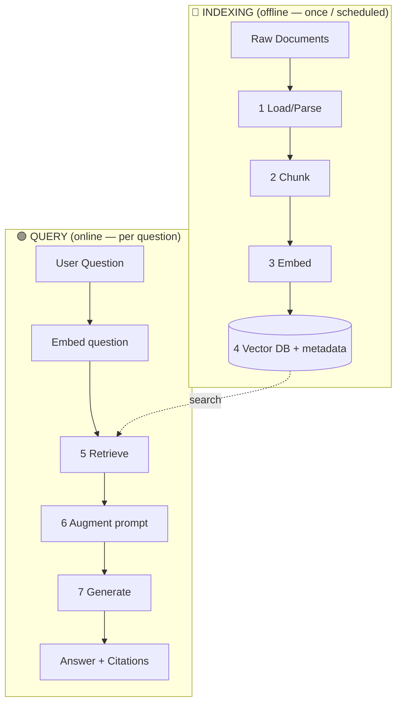
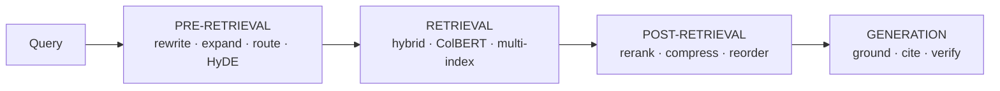
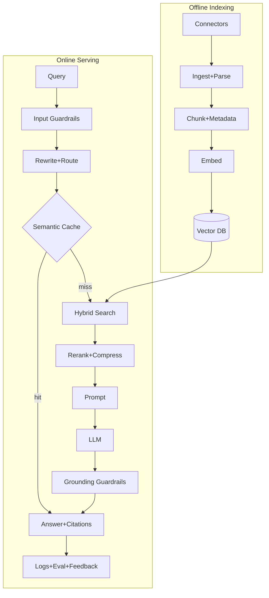

# 📚 RAG Complete Guide — Basic → Advanced → Production → Interview

> End-to-end resource to master Retrieval-Augmented Generation (RAG).
> Every concept is **one checkbox + a one-line explanation** — tick as you learn. Deeper callouts (code, tables, gotchas) appear only where they add value.
>
> **Legend:** 🏭 production-critical · 🎯 common interview question · ⚡ advanced · ⭐ recommended default
> View in VS Code with `Ctrl+Shift+V` (Mermaid diagrams render). Last updated: 2026.

---

## 📑 Table of Contents

1. **Part 0 — The Big Picture** (flow diagrams)
2. **Part 1 — Foundations** (what, why, comparisons, limitations, vocab)
3. **Part 2 — The Core Pipeline** (ingest → parse → chunk → embed → store → retrieve → generate)
4. **Part 3 — Advanced RAG** (pre/retrieval/post optimization, frontier, agent memory)
5. **Part 4 — Evaluation**
6. **Part 5 — Production & LLMOps**
7. **Part 6 — Interview** (Q&A + system design)
8. **Part 7 — Hands-On Practice Order**

---

---

# 🧭 PART 0 — THE BIG PICTURE

### RAG has TWO flows (the #1 thing to understand)



### The advanced optimization map



- [ ] **The RAG formula** — `Answer = LLM(Question + Retrieved_Context)`.
- [ ] **Indexing vs Query flows** — indexing is prepared offline; query runs live; they share only the vector DB.

---

---

# 🟦 PART 1 — FOUNDATIONS

## 1.1 What & Why

- [ ] **What is RAG** 🎯 — fetch relevant external knowledge at query time and feed it to the LLM.
- [ ] **Why: knowledge cutoff** — LLMs don't know anything after training; RAG injects fresh data.
- [ ] **Why: private data** — the model never saw your docs; RAG indexes them.
- [ ] **Why: hallucination** — grounding in real text reduces made-up facts.
- [ ] **Why: citations** — return the exact chunks used as sources.
- [ ] **Why: no retraining** — update the vector DB instead of retraining the model.

## 1.2 Comparisons 🎯

- [ ] **RAG vs Fine-tuning** — RAG changes _knowledge_; fine-tuning changes _behavior/style_.
- [ ] **RAG vs Long-context** — RAG wins on cost, freshness, precision, citations at scale; often combined.
- [ ] **When NOT to use RAG** — pure reasoning, tiny fixed knowledge, or behavior-change tasks.

## 1.3 Paradigms 🎯

- [ ] **Naive RAG** — the basic load→chunk→embed→store→retrieve→generate pipeline.
- [ ] **Advanced RAG** — adds pre-retrieval + post-retrieval optimization.
- [ ] **Modular RAG** — swappable modules: routing, memory, multiple retrievers, agents.

## 1.4 RAG Limitations & Challenges 🎯

- [ ] **Retrieval ceiling** — if retrieval misses, the LLM can't recover ("garbage in").
- [ ] **Chunk-boundary loss** — facts split across chunks can be lost (overlap/parent-doc help).
- [ ] **Context limits** — only so many chunks fit the prompt; must rank/compress.
- [ ] **Multi-hop weakness** — vector search struggles with questions needing linked facts (→ GraphRAG).
- [ ] **Stale index** — answers go wrong if the index isn't kept fresh.
- [ ] **Latency & cost** — extra retrieval + larger prompts add both.
- [ ] **Evaluation is hard** — need golden sets + metrics, not vibes.
- [ ] **Security surface** — retrieved text can carry injected/poisoned instructions.

## 1.5 Vocabulary

- [ ] **Chunk** — a small piece of a document (the retrieval unit).
- [ ] **Embedding / Vector** — numeric representation of meaning; similar → close.
- [ ] **Vector DB** — stores vectors, finds similar ones fast.
- [ ] **Semantic search** — search by meaning, not keywords.
- [ ] **Top-K** — the K most relevant chunks retrieved.
- [ ] **Token** — ~¾ word / ~4 chars; unit for limits & pricing.
- [ ] **Context window** — max tokens an LLM reads at once.
- [ ] **Grounding** — making the answer rely on retrieved facts.
- [ ] **Dense vs Sparse** — embeddings (meaning) vs keyword weights (BM25).

---

---

# 🟩 PART 2 — THE CORE PIPELINE

## 2.1 Ingestion & Parsing 🏭🎯

_Parsing quality is the #1 upstream lever — a perfect retriever can't fix wrongly-extracted text._

### Data sources

- [ ] **Data connectors** 🏭 — files, S3/GCS, Notion, Confluence, Google Drive, Slack, SQL/NoSQL, web crawlers, APIs.
- [ ] **Connector concerns** — auth, rate limits, incremental sync, carry source **permissions (ACLs)** into metadata.

### Loading & cleaning

- [ ] **Document loading** — read raw files and extract text (`PyPDFLoader`, `WebBaseLoader`, etc.).
- [ ] **Remove boilerplate** — strip headers/footers/page numbers.
- [ ] **Normalize text** — fix whitespace and hyphenation across line breaks.
- [ ] **Preserve hierarchy** — keep title→section→subsection as metadata.
- [ ] **Metadata capture** — source, page, date, author, section, permissions.

### Parsing hard content 🎯

- [ ] **Why parsing is hard** — tables, multi-column, scans, figures, forms all break naive extraction.
- [ ] **Tables → Markdown/HTML** 🎯 — serialize tables structurally so rows/columns survive (not raw text).
- [ ] **Header with rows** — repeat column headers in every table chunk.
- [ ] **Don't split tables mid-row** — keep a table (or row-group) as one unit.
- [ ] **Long tables** — split by rows, repeat the header, tag with the table title.
- [ ] **Table summarization** ⚡ — embed an LLM summary of a table, keep the full table for the answer.
- [ ] **Validate cell values** 🏭 — tables can look right but have wrong numbers/currency/footnotes.
- [ ] **Multi-column layout** — use a layout-aware parser to keep reading order.
- [ ] **Figures/charts** ⚡ — caption with a vision model, or use multimodal embeddings.
- [ ] **OCR** — add a text layer to scans (Tesseract, AWS Textract, Azure Document Intelligence).

### Parser tools 🎯

- [ ] **Heuristic/layout parsers** — fast, local: **Unstructured**, **Docling**, `pdfplumber`, Camelot/Tabula (tables).
- [ ] **Vision-first (VLM) parsers** ⚡ — best on messy docs: **LlamaParse**, **Reducto**, Azure DI.
- [ ] **Basic text extraction** — text layer only, no structure: `PyPDF`, `PyMuPDF`.
- [ ] **Hybrid/fallback + test hardest pages** 🏭 — fast parser for clean PDFs, vision parser for hard pages; pick by your worst documents.

## 2.2 Chunking 🏭🎯

- [ ] **Why chunk** — embedding token limits + retrieval precision + LLM context limits.
- [ ] **chunk_size** — max size of a chunk (chars or tokens).
- [ ] **chunk_overlap** — repeated text between chunks so boundary ideas aren't lost.
- [ ] **separators** — allowed cut points (`\n\n`, `\n`, space, …).
- [ ] **CharacterTextSplitter** — splits on one separator; can emit oversized chunks.
- [ ] **RecursiveCharacterTextSplitter** ⭐ — tries separators in order, recurses on big pieces (default for RAG).
- [ ] **Why "recursive"** — re-applies itself to any piece still too big until all fit.
- [ ] **TokenTextSplitter** — splits by token count instead of characters.
- [ ] **MarkdownHeader / HTMLHeader splitters** — split structured docs by headings.
- [ ] **Code splitting** — split source code at functions/classes.
- [ ] **Semantic chunking** ⚡ — split where meaning changes.
- [ ] **Agentic chunking** ⚡ — an LLM decides chunk boundaries.
- [ ] **Late chunking** ⚡ — embed the whole doc first, then chunk, to keep long-range context.
- [ ] **Proposition-based chunking** ⚡ — break text into atomic factual statements, index each.
- [ ] **Overlap gotcha** 🎯 — character splitter carries overlap as whole lines; if lines > overlap, no overlap appears.
- [ ] **Oversized-chunk gotcha** — if a line > `chunk_size`, character splitter emits an oversized chunk (recursive avoids it).
- [ ] **Prod sizing** 🏭 — ~256–1024 tokens, 10–20% overlap, measured in tokens; structure-aware first.

## 2.3 Embeddings 🎯

- [ ] **What is an embedding** — text → vector capturing meaning; similar meanings sit close.
- [ ] **Cosine similarity** ⭐ — angle between vectors (most common).
- [ ] **Dot product** — similarity for normalized vectors.
- [ ] **Euclidean (L2) distance** — straight-line distance.
- [ ] **Dense embeddings** — semantic meaning vectors.
- [ ] **Sparse embeddings** — keyword-weight vectors (BM25, SPLADE) for exact terms.
- [ ] **Multi-vector / ColBERT (late interaction)** ⚡ — one vector per token; high accuracy, more storage.
- [ ] **Dimensions** — vector length; bigger = more expressive, more storage.
- [ ] **Max tokens** — biggest input the model accepts (must fit your chunk).
- [ ] **OpenAI embeddings** — `text-embedding-3-small/large`.
- [ ] **Open-source embeddings** — Sentence-Transformers, BGE, E5, GTE, Nomic.
- [ ] **Instruction-tuned embeddings** — prepend `query:` / `passage:` (E5/BGE/GTE).
- [ ] **Matryoshka embeddings** ⚡ — truncate dims (e.g. 1536→256) to trade accuracy for speed/storage.
- [ ] **Embedding quantization** ⚡ — store vectors as int8/binary to cut memory ~4–32× with small loss.
- [ ] **Fine-tuning embeddings** ⚡ — train on domain pairs for better retrieval.
- [ ] **Same-model rule** 🎯 — use the same embedding model for indexing and querying.
- [ ] **Normalize + batch** 🏭 — normalize for dot product; batch calls for throughput.
- [ ] **Re-index cost** — changing embedding models means re-embedding everything.
- [ ] **MTEB** — standard leaderboard for embedding quality.
- [ ] **Non-RAG uses** — recommendation, anomaly detection, classification/clustering, dedup.

## 2.4 Vector Stores & Indexing 🏭🎯

- [ ] **What a vector DB does** — store vectors and find the nearest fast.
- [ ] **ANN** 🎯 — Approximate Nearest Neighbor; fast approximate search vs slow exact.
- [ ] **HNSW** — graph-based ANN index (most popular).
- [ ] **IVF** — cluster vectors, search nearest clusters.
- [ ] **PQ (Product Quantization)** — compress vectors to save memory.
- [ ] **Flat/exact index** — brute force; accurate but slow (small data).
- [ ] **Recall vs speed tradeoff** 🎯 — ANN trades a little recall for big speed.
- [ ] **Vector DBs** — FAISS (local lib), Chroma (local), Pinecone (managed), Qdrant/Weaviate/Milvus (OSS scale), pgvector/Supabase (Postgres), LanceDB (embedded), Elasticsearch/OpenSearch (vector+BM25), Mongo/Redis.
- [ ] **Indexing embeddings** — load vectors into the search structure.
- [ ] **Similarity search** — query for nearest vectors.
- [ ] **Metadata filtering** 🏭🎯 — restrict search by fields (date, dept, access) — key for permissions + multi-tenancy.

## 2.5 Retrieve → Augment → Generate 🎯

- [ ] **Top-K retrieval** — fetch the K most similar chunks.
- [ ] **MMR** — retrieve relevant _and_ diverse chunks (de-dup).
- [ ] **Score threshold** — only return chunks above a confidence.
- [ ] **Augmentation** — insert retrieved chunks into the prompt.
- [ ] **Grounding prompt** 🏭 — instruct the LLM to answer only from context.
- [ ] **"I don't know" fallback** — let the model refuse when context lacks the answer.
- [ ] **Generation** — LLM writes the grounded answer.
- [ ] **Return citations** — show which chunks the answer came from.

### Minimal end-to-end

```python
from langchain_community.document_loaders import PyPDFLoader
from langchain_text_splitters import RecursiveCharacterTextSplitter
from langchain_openai import OpenAIEmbeddings
from langchain_community.vectorstores import FAISS

docs   = PyPDFLoader("doc.pdf").load()
chunks = RecursiveCharacterTextSplitter(chunk_size=1000, chunk_overlap=200).split_documents(docs)
store  = FAISS.from_documents(chunks, OpenAIEmbeddings())
context = store.as_retriever(search_kwargs={"k": 4}).invoke("your question")
# build grounded prompt with context → LLM → answer + sources
```

---

---

# 🟧 PART 3 — ADVANCED RAG

## 3.1 Pre-Retrieval ⚡🎯

- [ ] **Query rewriting** — clean up a messy query before searching.
- [ ] **Multi-query** — generate several rephrasings and search all.
- [ ] **RAG-Fusion** — multi-query + Reciprocal Rank Fusion.
- [ ] **RRF** — formula to merge multiple ranked lists.
- [ ] **HyDE** — embed a hypothetical answer and search with it.
- [ ] **Step-back prompting** — ask a broader question first.
- [ ] **Query decomposition** — break a complex question into sub-questions.
- [ ] **Routing** — send the query to the right index/tool/DB.
- [ ] **Self-query** — LLM extracts metadata filters from natural language.

## 3.2 Retrieval ⚡🏭

- [ ] **Hybrid search** 🎯 — combine dense (semantic) + sparse (keyword), merge via RRF.
- [ ] **ColBERT / late interaction** ⚡ — token-level matching for accuracy.
- [ ] **Parent Document Retriever** — match small chunks, return the larger parent.
- [ ] **Sentence-window retrieval** — match a sentence, return its neighbors.
- [ ] **Contextual Retrieval** — prepend an LLM-written context blurb to each chunk before embedding.
- [ ] **Multi-vector / summary indexing** — index summaries, fetch full docs.
- [ ] **RAPTOR** — hierarchical tree of summaries for multi-level retrieval.

## 3.3 Post-Retrieval ⚡🏭🎯

- [ ] **Reranking** 🎯 — re-score retrieved chunks with a cross-encoder; keep the best (high ROI).
- [ ] **Bi-encoder** — embeds query/doc separately (fast, retrieval).
- [ ] **Cross-encoder** — reads query+doc together (accurate, reranking).
- [ ] **Context compression** — drop irrelevant sentences to save tokens (LLMLingua).
- [ ] **"Lost in the middle"** 🎯 — LLMs ignore mid-context; put best chunks at the edges.
- [ ] **Context re-ordering** — arrange chunks so top ones sit first/last.
- [ ] **Deduplication** — remove near-identical chunks.

## 3.4 Generation-Side ⚡

- [ ] **Groundedness/faithfulness check** — verify the answer is supported; regenerate if not.
- [ ] **Structured output** — force JSON/schema answers.
- [ ] **Self-consistency** — sample multiple answers, pick the consistent one.
- [ ] **RAG prompt engineering** — grounding instruction + "I don't know" + citation format.

## 3.5 Frontier Architectures ⚡🎯

- [ ] **Agentic RAG** — the LLM decides when/what/how to retrieve, in a loop.
- [ ] **Self-RAG** — the model critiques its own retrieval/answer and retries.
- [ ] **Corrective RAG (CRAG)** — grade docs; fall back to web search if poor.
- [ ] **Adaptive RAG** — route by query complexity (no/single/multi-step retrieval).
- [ ] **GraphRAG** — retrieve over a knowledge graph for multi-hop/global questions.
- [ ] **Multimodal RAG** — retrieve over images/tables/audio/video.
- [ ] **RAFT** — fine-tune the model to use retrieved context and ignore distractors.
- [ ] **Conversational RAG** 🏭 — rewrite follow-ups using chat history before retrieving.

## 3.6 RAG for Agents: Memory & MCP ⚡🎯

- [ ] **Short-term memory** — current conversation held in the prompt.
- [ ] **Long-term memory** — knowledge persisted across sessions (vector DB/SQL).
- [ ] **Episodic memory** — memories of specific past events.
- [ ] **Semantic memory** — general facts and knowledge.
- [ ] **Procedural memory** — how to do tasks (skills/tools).
- [ ] **Summarization/compression** — condense old turns to fit context.
- [ ] **Forgetting/aging** — decay or drop stale memories.
- [ ] **User profile storage** — persist preferences for personalization.
- [ ] **MCP (Model Context Protocol)** — open standard to plug tools/data into agents.
- [ ] **MCP Host/Client/Server** — the app, the connector, the tool/data provider.
- [ ] **RAG Agent** — an agent that decides whether/what/when to retrieve iteratively.

## 3.7 Frameworks 🏭

- [ ] **LangChain** — broad RAG/agent ecosystem.
- [ ] **LlamaIndex** — data/index-centric, advanced retrievers.
- [ ] **Haystack** — production pipeline framework.
- [ ] **LangGraph** — stateful/agentic RAG graphs.
- [ ] **DSPy** ⚡ — programmatic prompt/pipeline optimization.
- [ ] **Guardrails / NeMo Guardrails** — output validation & safety.
- [ ] **Implementation paths** 🎯 — from scratch (SDKs) · frameworks · managed (OpenAI Assistants, Bedrock KB, Vertex/Azure Search).

---

---

# 🟨 PART 4 — EVALUATION 🏭🎯

- [ ] **Evaluate two things separately** 🎯 — retrieval quality vs generation quality.
- [ ] **Context Precision** — of retrieved chunks, how many are relevant.
- [ ] **Context Recall** — of all relevant chunks, how many were retrieved.
- [ ] **Hit Rate** — did we retrieve at least one relevant chunk.
- [ ] **MRR** — how high the first relevant chunk ranked.
- [ ] **NDCG** — ranking quality weighted by position.
- [ ] **Faithfulness / Groundedness** — is the answer supported by context (anti-hallucination).
- [ ] **Answer Relevancy** — does the answer address the question.
- [ ] **Correctness** — does the answer match ground truth.
- [ ] **RAG Triad** 🎯 — context relevance + groundedness + answer relevance.
- [ ] **Offline evaluation** — run a fixed golden set before deploy.
- [ ] **Online evaluation** — monitor live traffic + user feedback.
- [ ] **Golden dataset** — curated (question, answer, chunks) to test changes.
- [ ] **Synthetic eval data** — auto-generate test questions, then human-review.
- [ ] **LLM-as-a-judge** — a strong LLM grades answers (scalable, needs calibration).
- [ ] **Tools** — RAGAS ⭐, TruLens, DeepEval, LangSmith, Arize Phoenix, Langfuse.
- [ ] **Benchmarks** — BEIR (retrieval), MTEB (embeddings), public RAG QA sets.

---

---

# 🟥 PART 5 — PRODUCTION & LLMOps 🏭

### Production architecture



## 5.1 The Prototype→Prod Gap 🎯

- [ ] **Why demos fail at scale** — accuracy drops, latency balloons, cost grows, permissions/compliance missing, data goes stale.

## 5.2 Latency

- [ ] **Semantic cache** — reuse answers for similar past queries.
- [ ] **Prompt cache** — cache the static system prompt.
- [ ] **Async/parallel retrieval** — run retrieval + reranking concurrently.
- [ ] **Streaming** — stream tokens for perceived speed.
- [ ] **Smaller/faster models** — where quality allows.
- [ ] **Precompute embeddings** — offline; warm indexes.

## 5.3 Cost

- [ ] **Fewer, better chunks** — rerank + compress to cut prompt tokens.
- [ ] **Prompt caching** — cut repeated input cost.
- [ ] **Cheaper models + quantized/Matryoshka embeddings** — cut compute/storage.
- [ ] **Monitor tokens & $/query** — track cost per request.

## 5.4 Security & Governance 🎯

- [ ] **Access control (ACL) filtering** — only retrieve docs the user may see.
- [ ] **Multi-tenancy** — isolate each tenant's data (namespaces/metadata).
- [ ] **PII handling** — detect/redact/mask sensitive data.
- [ ] **Prompt injection defense** 🎯 — treat retrieved text as untrusted; ignore embedded instructions.
- [ ] **Data poisoning / KB integrity** — validate ingested content; a malicious doc can corrupt answers.
- [ ] **Audit logging** — record who asked what and what was retrieved.
- [ ] **Compliance** — GDPR/HIPAA/SOC2, data residency.

## 5.5 Data Freshness

- [ ] **Incremental indexing (upserts)** — add/update/delete vectors with stable IDs.
- [ ] **Document versioning** — handle updates without duplicates.
- [ ] **Change-data-capture / re-crawl** — keep the index current.
- [ ] **Ingestion orchestration** — Airflow / Dagster / Prefect pipelines.

## 5.6 Reliability

- [ ] **Hallucination controls** — grounding + verification + citations + thresholds.
- [ ] **Fallback strategy** — web search / clarify / refuse when retrieval is weak.
- [ ] **Guardrails** — validate inputs and outputs.
- [ ] **Graceful degradation** — keep serving if a component (reranker/LLM) is down.

## 5.7 Scaling

- [ ] **Sharding & replication** — scale the vector index.
- [ ] **Distributed vector DBs** — Milvus/Qdrant cluster, Pinecone.
- [ ] **GPU** — for embedding/reranking throughput.
- [ ] **Horizontal scaling + queues** — scale serving and ingestion.

## 5.8 LLMOps

- [ ] **Observability** — log query, chunks+scores, prompt, answer, latency, cost, feedback (LangSmith/Phoenix/Langfuse).
- [ ] **CI/CD for RAG** — run the eval set in the pipeline; block regressions.
- [ ] **A/B testing & canary** — safely roll out retrieval/prompt/model changes.
- [ ] **Version everything** — data, index, embeddings, prompts, models.
- [ ] **Feedback loops** — capture thumbs up/down to improve.

---

---

# 🟪 PART 6 — INTERVIEW

## 6.1 Question Bank (use as a self-test)

### Fundamentals

1. **What is RAG & why?** Inject external knowledge at query time → fixes cutoff, private data, hallucination, citations; no retraining.
2. **RAG vs fine-tuning?** Knowledge (changing facts) vs behavior/style; combine for maturity (RAFT).
3. **RAG vs long-context — is RAG dead?** No — wins on cost, latency, precision, freshness, citations; often combined.
4. **When NOT to use RAG?** Pure reasoning, tiny fixed knowledge, behavior-change tasks.
5. **Naive vs Advanced vs Modular RAG?** Basic pipeline → +pre/post optimization → swappable modules/agents.
6. **Main limitations of RAG?** Retrieval ceiling, chunk-boundary loss, context limits, multi-hop weakness, staleness, latency/cost, eval difficulty, security.

### Parsing & Ingestion

7. **How parse complex PDFs?** Layout/vision parser, preserve reading order, OCR scans, strip boilerplate, keep metadata; test hardest pages.
8. **How parse long tables?** Markdown/HTML to keep structure, repeat header per chunk, never split mid-row; huge tables → row-chunks with headers; optionally embed a summary and keep the full table.
9. **Why not plain-text a table?** Flattens rows/columns into gibberish, loses relationships.
10. **Multi-column layouts?** Layout-aware parser preserves reading order.
11. **Images/charts?** Caption with a vision model, or multimodal embeddings.
12. **Heuristic vs vision-first parsers?** Rules/layout (fast, local) vs VLM (best on messy docs); combine as fallback.

### Chunking

13. **Why chunk?** Token limits, precision, context limits.
14. **Choose chunk size?** Precise-vs-context tradeoff; ~256–1024 tokens, 10–20% overlap; tune via eval.
15. **What is overlap for?** Preserve boundary ideas across chunks.
16. **Recursive vs Character splitter?** Multiple separators + recursion; overlap by chars; avoids oversized chunks.
17. **Semantic/late/proposition chunking?** Split by meaning / embed-then-chunk / atomic facts.

### Embeddings & Vector Search

18. **What is an embedding?** Vector of meaning; similar → close.
19. **Similarity metrics?** Cosine, dot, Euclidean.
20. **Same model for index & query?** Yes — spaces must match.
21. **Dense vs sparse vs multi-vector?** Semantic vs keyword vs token-level (ColBERT).
22. **Matryoshka / quantization?** Truncatable dims / int8-binary storage to cut cost.
23. **What is ANN; why not exact?** Too slow at scale; HNSW/IVF/PQ trade recall for speed.
24. **Compare vector DBs.** FAISS local / Pinecone managed / Chroma proto / pgvector Postgres / Qdrant OSS-fast.
25. **Metadata filtering — why?** Permissions, multi-tenancy, relevance.

### Retrieval Quality

26. **Hybrid search?** Dense + sparse (BM25), merge via RRF.
27. **Reranking?** Cross-encoder re-scores many; keep best. High ROI.
28. **Bi- vs cross-encoder?** Separate-fast vs joint-accurate.
29. **MMR?** Relevant + diverse retrieval.
30. **HyDE / multi-query / RAG-Fusion?** Hypothetical-answer embed / N rephrasings / +RRF merge.
31. **Query decomposition / step-back?** Split complex Q / ask broader Q first.
32. **Parent-doc / sentence-window?** Match small, return larger context.
33. **Contextual Retrieval / RAPTOR?** Prepend context to chunks / hierarchical summaries.
34. **Context compression?** Drop irrelevant sentences to cut tokens/noise.
35. **"Lost in the middle"?** LLMs ignore mid-context; reorder best to edges.

### Evaluation

36. **How evaluate RAG?** Retrieval (precision/recall/hit-rate/MRR/NDCG) + generation (faithfulness/relevancy/correctness); golden set + RAGAS.
37. **RAG Triad?** Context relevance, groundedness, answer relevance.
38. **Faithfulness vs answer relevancy?** Supported-by-context vs addresses-the-question.
39. **Offline vs online eval?** Fixed golden set vs live-traffic monitoring + feedback.
40. **Benchmarks?** BEIR (retrieval), MTEB (embeddings).

### Production

41. **Why demos fail in prod?** Scale, latency, cost, permissions, staleness.
42. **Reduce latency?** Caching, async, rerank-fewer, smaller models, streaming.
43. **Reduce cost?** Fewer/better chunks, prompt caching, cheaper/quantized models, monitor tokens.
44. **Document permissions?** Access metadata + filter retrieval by user.
45. **Prompt injection via docs?** Untrusted context; instruct to ignore; sanitize; sandbox.
46. **Data poisoning?** Validate ingested content; a malicious doc can corrupt answers.
47. **Keep index fresh?** Upserts + stable IDs, versioning, CDC, re-crawl.
48. **Reduce hallucination?** Grounding + "I don't know" + verification + citations + thresholds.
49. **No good retrieval — what do you do?** Fallback (web search/clarify/refuse), never force.
50. **Monitor + CI/CD for RAG?** Log all stages + scores + cost + feedback; eval set in pipeline; A/B + canary.

### Advanced / Agents

51. **Agentic RAG?** LLM decides when/what to retrieve, loops, tools, self-corrects.
52. **Self-RAG vs CRAG vs Adaptive RAG?** Self-critique+retry / grade-docs+web-fallback / route-by-complexity.
53. **GraphRAG — when?** Multi-hop + global/thematic questions over a knowledge graph.
54. **Multimodal RAG?** Retrieve over images/tables/audio via multimodal embeddings.
55. **Conversational RAG?** History-aware query rewriting before retrieval.
56. **RAFT?** Fine-tune the model to use retrieved context and ignore distractors.
57. **Agent memory types?** Short-term (prompt), long-term (DB), episodic (events), semantic (facts), procedural (skills).
58. **Episodic vs semantic memory?** Events vs facts; both retrieved via RAG.
59. **Manage long-term memory?** Profiles, summarization, forgetting/aging, selective writes.
60. **What is MCP?** Open standard (Host/Client/Server) to plug tools & data into agents; makes RAG a pluggable tool.

## 6.2 System Design — "RAG for 10M enterprise docs" 🎯

1. **Ingestion** — connectors + robust parsing (tables/scans) + OCR.
2. **Chunking** — structure-aware + recursive, token-measured, rich metadata incl. **ACLs**.
3. **Embeddings** — strong model (domain-tuned if needed); batch; mind storage.
4. **Store** — scalable vector DB with metadata + permission filters, sharded/replicated.
5. **Retrieval** — hybrid + reranking + compression + reorder.
6. **Generation** — grounded prompt, citations, "I don't know".
7. **Security** — ACL filtering, PII redaction, injection/poisoning defense, audit logs.
8. **Performance** — semantic + prompt caching, async, streaming.
9. **Ops** — eval set + monitoring + A/B + incremental re-indexing + alerting.
10. **Advanced** — agentic/adaptive routing, conversational memory.

---

---

# 🛠️ PART 7 — HANDS-ON PRACTICE ORDER

1. Minimal RAG (PDF → FAISS → retrieve → LLM).
2. Swap to `RecursiveCharacterTextSplitter`; tune chunk size (token-based).
3. Improve parsing (tables → Markdown, layout-aware parser).
4. Swap to Chroma/Qdrant + metadata filtering.
5. Add **hybrid search + reranking**.
6. Add **query rewriting / multi-query / HyDE**.
7. Add **context compression + reorder**.
8. Add **RAGAS evaluation** + golden set.
9. Add **conversational memory** (history-aware retrieval).
10. Add **caching + permissions + monitoring**.
11. Build **Agentic/Adaptive RAG with LangGraph**.
